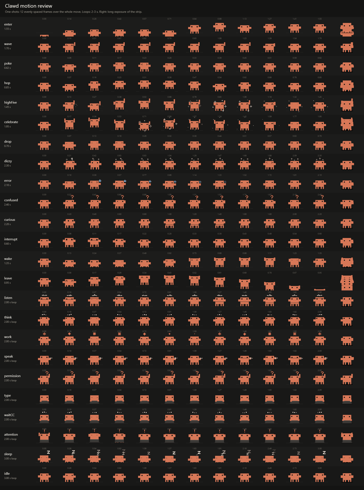

# Clawd

A little pixel-art buddy that lives on your Windows desktop, with his own AI agent. Ask him quick
questions, have him read and summarize a web page, or let him read a Reddit thread and polish the
comment you're writing, then put it back in the box for you to post.

Clawd is a fan-made recreation of Anthropic's mascot. It is not affiliated with or endorsed by
Anthropic.



## What he does

- **Lives on your desktop.** 12 × 8 pixel art at the real mascot's proportions, animated in real
  time (120 fps, ~0.05 ms per frame, under 1 % CPU when idle). He breathes, blinks, glances at your
  pointer, sits down and naps when it's quiet. Poke him, double-click him to talk, drag him
  anywhere, rest the pointer on him for a high-five, or click him three times quickly and watch the
  stars. Only his own pixels catch the mouse; everything around him stays clickable.
- **A side buddy, not a chatbot.** Summon him and a small panel opens next to him, already
  listening. Talk, or just start typing (typing stops the mic). Answers come back as one result
  card with ways to use it: **Put in comment box**, **Replace selection**, **Copy**, **Insert**,
  **Compare** with your original, and one-tap tweaks (**Shorter**, **More casual**, **More formal**,
  **Friendlier**). Earlier results live in History.
- **Knows what you're looking at.** When summoned he notes the app, the page URL, any selected text
  and the comment you're typing, and offers matching quick actions: *Refine my comment*,
  *Summarize the thread*, *Summarize this page*, *Key takeaways*, *Refine / Shorten / Fix grammar /
  Explain* for a selection, *Explain this error*.
- **Voice.** "Hey Clawd" wake word, local speech recognition and Clawd's own voice, all on your PC
  (sherpa-onnx: keyword spotter, Silero VAD, Moonshine, Kokoro). Audio never leaves the machine.
- **A real agent.** Model-independent tool use (local Ollama by default; OpenAI, Anthropic,
  Gemini or any OpenAI-compatible server optional) with 43 tools: web search and page reading,
  the browser extension, screen and selection context, files (with undo), documents, clipboard,
  apps, commands, keyboard and mouse, memory, skills, notifications and Claude Code. Multi-step
  plans, retries, a loop guard, step limits, timeouts and cancellation.
- **Asks before acting.** Every tool has a permission category (Allow / Ask / Deny per category,
  three presets). High-risk actions always ask. Outside content (a web page and its title, files,
  other apps) is fenced off as untrusted, so instructions inside it are never followed, and once it
  is part of a task anything beyond low risk asks first. So does any request to a web address that
  didn't come from you or from what he read, so injected text can't smuggle your data out in a URL.
  Commands never get an "Always allow", network paths are refused, and commands he runs don't
  inherit API keys. He never posts or sends anything on your behalf.
- **His own cursor.** When he shows you something he moves his own teardrop cursor (smooth or
  pixel style) along a gentle curve with motion trails, while a soft glow runs around the screen
  edges.
- **Claude Code companion.** Through Claude Code's hooks he follows your sessions: a tiny laptop
  comes out while Claude Code works, he perks up when it needs your approval or input, and he can
  tell you what it's doing.
- **Memory, skills, tasks.** Remembers what you ask him to (you approve each memory), uses a skills
  library (comment refining, writing polish, web research, build triage, file organising), and
  keeps a task timeline with step details and undo for file changes.
- **Plus:** global shortcuts, focus mode, notifications, quick suggestions, clipboard companion
  (off by default), start with Windows, and a full settings app.

## Install

**The easy way:** give [INSTALL-WITH-CLAUDE.txt](INSTALL-WITH-CLAUDE.txt) to Claude Code (or any
Claude that can run commands on your PC) and say *"Install and open Clawd using this file."* Claude
checks what your PC is missing, asks you once, then installs the tools, builds Clawd, installs it,
pulls the local AI model and opens him.

**By hand:** there is no prebuilt download yet: build the installer from source (see
[Build from source](#build-from-source)); `npm run dist` writes `dist\Clawd-Setup-0.1.0.exe`. It
installs for your user only (no admin rights) and starts Clawd. The installer is **not
code-signed**, so Windows SmartScreen may warn on first run: choose **More info → Run anyway**.

On first start Clawd waves hello and asks whether you want to talk to him. Voice needs a one-time
~620 MB download of speech models (into `%APPDATA%\Clawd\models`); you can also start it later from
the mic button in his panel or Settings → Voice. Once the models are there he asks separately
about the "Hey Clawd" wake word, which keeps the microphone open.

### AI model

Default: **Ollama** with `qwen3.5:4b`, entirely local.

1. Install [Ollama](https://ollama.com) and run `ollama pull qwen3.5:4b`.
2. Clawd finds it at `http://127.0.0.1:11434`. Settings → AI shows the status and lets you pick
   another installed model, the context size and keep-alive.

To use a hosted model instead, pick OpenAI, Anthropic, Gemini or "OpenAI-compatible" in
Settings → AI and paste your API key there. Keys are encrypted with Windows DPAPI and never
written in plain text. With a hosted model, Clawd asks before sending your screen, selection or
page content to it (Permissions & privacy → Cloud context). You can set Ollama as the fallback
when the hosted model is unreachable.

### Shortcuts and wake word

| Action | Default |
| --- | --- |
| Summon Clawd (opens the panel, listening) | Ctrl + Alt + Space |
| Start or stop voice input | Ctrl + Alt + V |
| Cancel the current task | Ctrl + Alt + Backspace |
| Hide or show Clawd | Ctrl + Alt + H |
| Focus mode | Ctrl + Alt + F |
| Open settings | Ctrl + Alt + , |

Double-clicking Clawd also summons him. If another app already owns Ctrl + Alt + Space, Clawd
moves summon to the first free alternative (Ctrl + Alt + C, then Ctrl + Alt + K) and tells you.
Settings → Shortcuts lets you record your own; it warns about combinations another app owns or
that type a character on your keyboard layout (AltGr).

Wake word: say **"Hey Clawd"**. It is off until you agree to it (the microphone stays open for the
wake word, processed locally). Change the phrase and sensitivity in Settings → Voice. "Listen when
I open Clawd" can be turned off there too.

### Start with Windows

Settings → General → Start with Windows. This adds a per-user entry
(`HKCU\Software\Microsoft\Windows\CurrentVersion\Run`, no admin). "Start tucked away" keeps him in
the tray at login until you summon him.

### Claude Code

Settings → Integrations → Claude Code → **Install hooks**. Clawd adds observer-only hook entries
to `~/.claude/settings.json` (a backup is made first) next to any hooks other tools put there, and
**Remove hooks** takes out only his own. The hooks run asynchronously, always exit 0 and print
nothing, so they can never block or change a Claude Code session.

### Browser extension (whole pages and comment drafts)

Without the extension Clawd can still read pages by fetching their URL. The extension lets him read
the page exactly as you see it (including Reddit threads and your comment draft) and put a refined
comment back into the box.

1. In Chrome, Edge, Brave, Arc or another Chromium browser open `chrome://extensions`, turn on
   **Developer mode**, click **Load unpacked** and pick the extension folder (Settings →
   Integrations → Browser → **Open extension folder**).
2. Settings → Integrations → Browser → **Copy pairing code**, then click the Clawd extension icon
   and paste it.

The extension talks only to Clawd on `127.0.0.1` with that code. It never clicks Post, Send or
Submit.

## Build from source

Requirements: Windows 10/11 x64, Node.js 22+, .NET Framework 4.x (for the native helper; present
on every Windows install).

```bash
npm install
npm run build        # native helper (csc.exe) + electron-vite
npm run models       # optional for development: speech models into ./models
npm run dev          # run with hot reload
npm run dist         # build the installer into dist/
```

## Tests

```bash
npx vitest run           # 96 unit tests
npm run test:e2e         # 9 end-to-end suites, 83 checks, against the built app (npm run build first)
```

The end-to-end suites drive the real app on your desktop with throwaway data folders and leave
your settings, Claude Code config and startup entries untouched:

| Suite | Covers |
| --- | --- |
| smoke | Clawd on the desktop, panel, a real answer from the local model, settings, 120 fps, idle CPU |
| interactions | poke, double-click, high-five, drag and drop, real global-shortcut key presses, settings surviving a restart |
| startup | Start with Windows writes and removes the Run-key entry; login launch stays in the tray |
| pointer-glow | his cursor and the screen-edge glow |
| panel-buddy | Reddit "Refine my comment", result card actions, the Shorter tweak, History |
| voice-first | summon starts listening, typing stops it, a spoken request (Kokoro audio through a fake mic) is answered, Kokoro speaks inside the app |
| extension | real Chromium with the extension: pairing, Reddit thread reading, the shadow-DOM draft, refine, write-back, never posting |
| claude-code | hook install next to another tool's hooks, every hook event, a real `claude -p` session, clean uninstall |
| packaged | the installed build (`npm run dist` first): bundled resources, native helper, speech engine, a real answer |

`node tests/integration/voice-pipeline.mjs` checks the speech stack end to end (wake word across
six voices, false triggers, recognition accuracy and timing).

## Project layout

```
src/main/        Electron main: app wiring, windows, companion state, voice host, bridge server,
                 Claude Code hooks, shortcuts, tray, startup, native helper client
src/brain/       agent service (utility process): runner, providers, tools, permissions, memory,
                 skills, tasks and undo
src/voice/       speech service (utility process): wake word, VAD, recognition, Kokoro
src/character/   the pixel-art rig: anatomy, poses, states, engine, effects, cursor, director
src/renderer/    overlay (Clawd, his cursor, edge glow), panel, settings, audio
src/shared/      settings schema, IPC contract, quick actions, result splitting
native/          C# helper: UI Automation, input, screenshots, AltGr check
resources/       browser extension, Claude Code hook script, skills, icons, model list
tests/           unit (vitest), e2e (Playwright + Electron), integration (voice)
tools/sheets/    contact sheets for art and motion review
```

## Privacy

Everything runs on your PC by default: the model (Ollama), speech, memory and task history
(`%APPDATA%\Clawd`). Nothing is sent anywhere unless you pick a hosted model, and then Clawd asks
before including your screen, selection or page. Logs are in `%APPDATA%\Clawd\logs` and have API
keys and tokens redacted.

## Credits

Speech: [sherpa-onnx](https://github.com/k2-fsa/sherpa-onnx) with Silero VAD, Moonshine and Kokoro
models. Page extraction: Mozilla Readability. Icons: Lucide. Fonts: Geist, Silkscreen. Clawd is
Anthropic's mascot; this is an unofficial fan project.

## License

The code is released under the [MIT License](LICENSE). The license covers this project's code
only: Clawd, Claude and Anthropic are Anthropic's names and characters and are not licensed here.
Bundled third-party code keeps its own license (for example
`resources/extension/vendor/Readability.LICENSE.md`).
